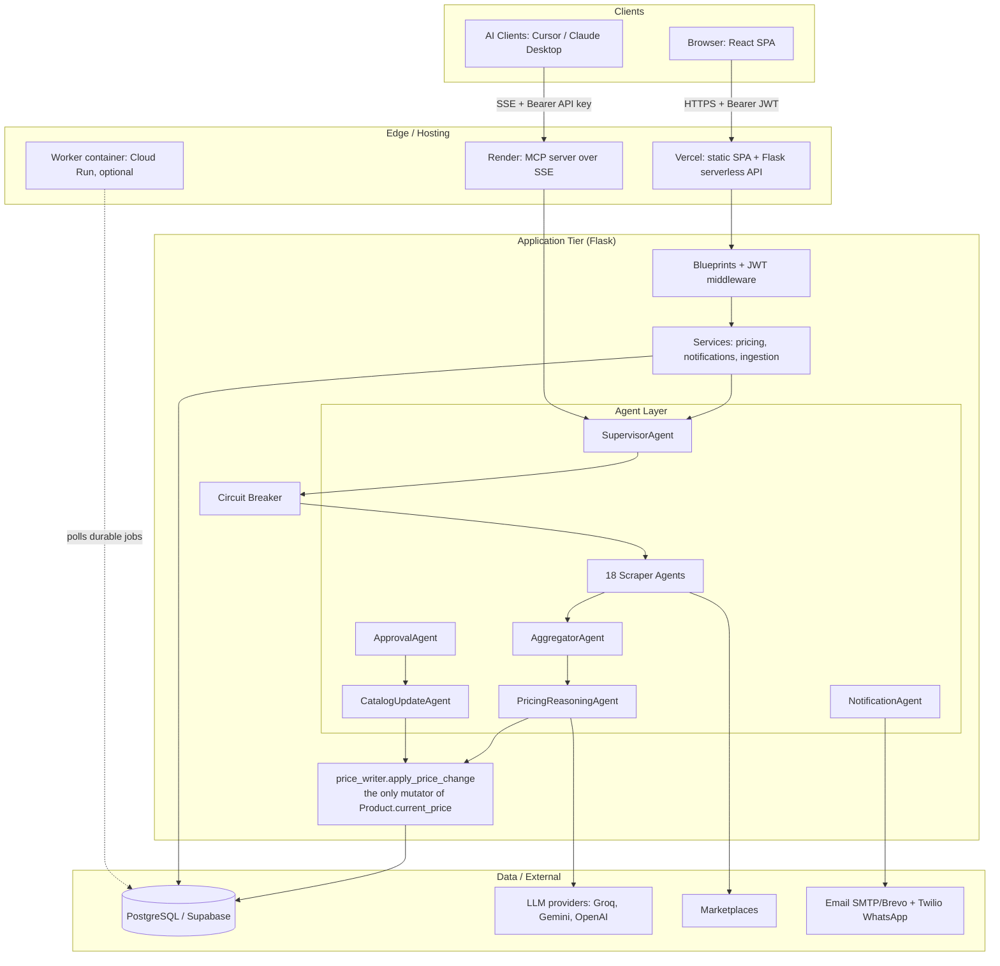
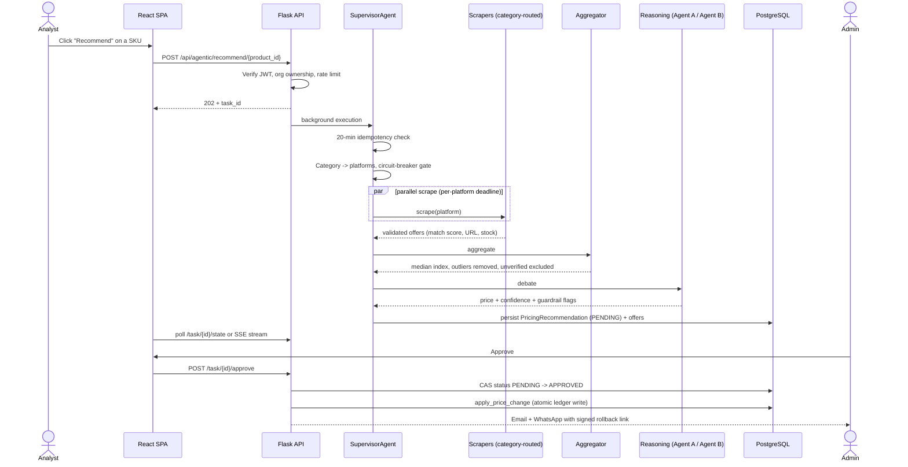
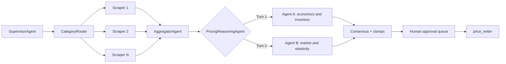
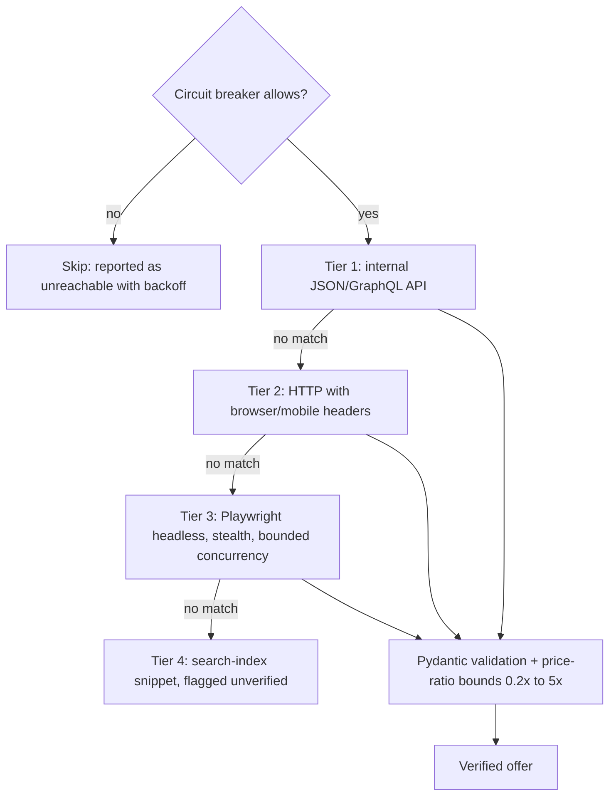
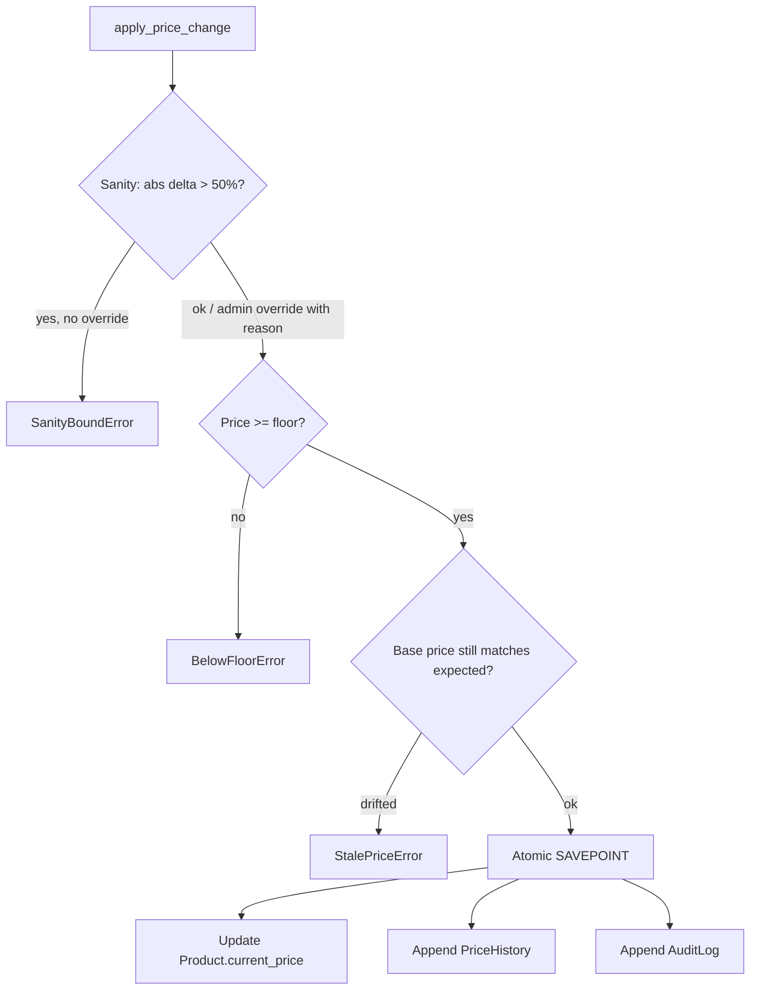
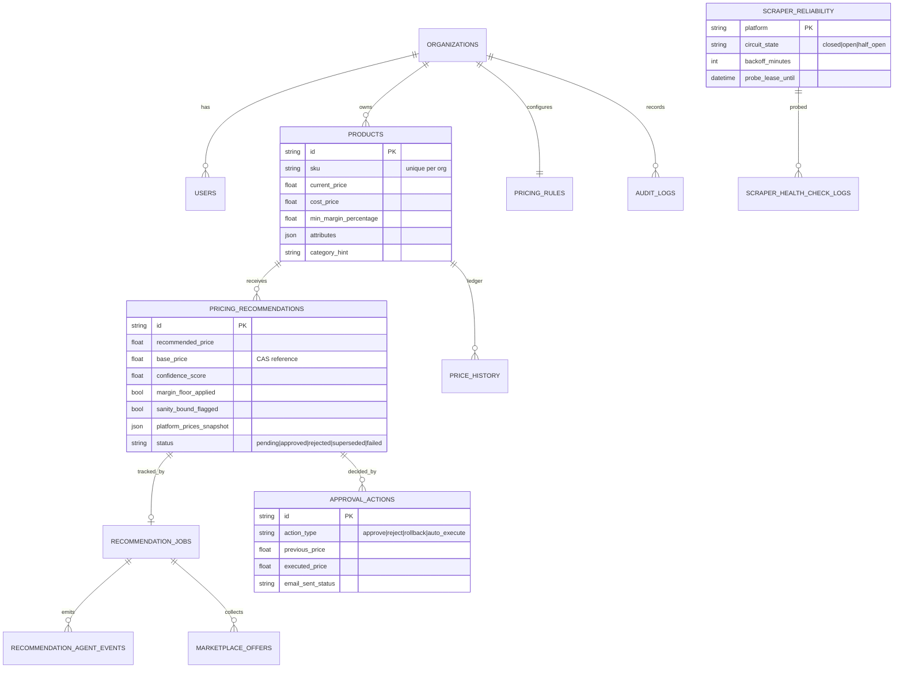

# Klypup: Dynamic Pricing Intelligence Platform

> A multi-tenant, multi-agent pricing platform for catalog-based e-commerce merchants. It scrapes live competitor prices, reasons about them with a dual-agent debate, enforces financial guardrails **in code** (not in prompts), and routes every price change through human approval with a full audit trail and one-click rollback.


**Live demo:** https://dynamic-pricing-intelligence-platfo.vercel.app/login
**Repository:** https://github.com/parthTyagi-tech/dynamic-pricing-intelligence-platform

---

## Table of Contents

1. [The Problem](#1-the-problem)
2. [What It Does](#2-what-it-does)
3. [System Architecture](#3-system-architecture)
4. [The Multi-Agent Pipeline](#4-the-multi-agent-pipeline)
5. [Scraper Engine](#5-scraper-engine)
6. [Pricing Guardrails and the Price Ledger](#6-pricing-guardrails-and-the-price-ledger)
7. [Security Model](#7-security-model)
8. [Data Model](#8-data-model)
9. [API Surface](#9-api-surface)
10. [MCP Server](#10-mcp-server-ai-client-integration)
11. [Frontend](#11-frontend)
12. [Tech Stack](#12-tech-stack)
13. [Repository Layout](#13-repository-layout)
14. [Getting Started](#14-getting-started)
15. [Deployment](#15-deployment)
16. [Testing](#16-testing)
17. [Known Limitations and Roadmap](#17-known-limitations-and-roadmap)
18. [Engineering Reflections](#18-engineering-reflections)
19. [License](#19-license)

---

## 1. The Problem

Mid-size merchants with hundreds of SKUs usually keep catalogs in CSV/ERP exports and reprice weekly in spreadsheets. The result:

| Pain | Consequence |
|---|---|
| Slow reaction to competitor price moves | Lost sales and revenue leakage |
| Static prices during demand swings | Missed margin on hot items, stuck stock on slow ones |
| Analysts spend time collecting data | Little time left for decisions |
| Algorithmic repricing is opaque | Teams can't trust it, so they don't adopt it |

Klypup treats **trust** as the core product problem. The AI proposes, the system verifies, a human decides, and everything is recorded.

---

## 2. What It Does

- **Live competitor intelligence** across **18 Indian marketplaces** (Amazon.in, Flipkart, Croma, Myntra, Ajio, Meesho, Nykaa, Purplle, BigBasket, JioMart, Blinkit, Pepperfry, Urban Ladder, 1mg, PharmEasy, CaratLane, Tanishq, Scooboo), routed by product category.
- **Dual-agent pricing debate**: Agent A defends margin and inventory economics; Agent B reads the market. A consensus step produces one price and a human-readable rationale.
- **Code-enforced guardrails**: margin floor, ±50% sanity bound, stale-price detection, evidence-quality filters.
- **Human-in-the-loop approvals** with compare-and-swap decisions, immutable price history, audit logs, and email/WhatsApp notifications.
- **One-click rollback** (UI, API, or signed email link) with anti-replay protection.
- **Multi-tenancy**: every table and query is scoped by `organization_id` derived from the JWT.
- **Operational telemetry**: per-platform circuit breakers, canary health checks, LLM call observability (latency, tokens, cost).
- **MCP server** so external AI clients (Cursor, Claude Desktop) can run scrapes, swarms, approvals and rollbacks as tools.
- **Catalog onboarding** via CSV/XLSX upload (with formula-injection neutralization) or store connection.

---

## 3. System Architecture

### 3.1 High-level topology



### 3.2 Layers

| # | Layer | Responsibility | Key files |
|---|---|---|---|
| 1 | Presentation | React SPA: catalog, approvals, scraper hub, competitor matrix, onboarding | `frontend/src/` |
| 2 | API gateway | JWT auth, tenant scoping, RBAC decorators, rate limiting, error envelopes | `backend/app/routes/`, `backend/app/middleware/` |
| 3 | Orchestration | Supervisor: idempotency cache, category routing, circuit-breaker gating, task state | `agentic/supervisor_agent.py`, `task_state/task_manager.py` |
| 4 | Sensors | Per-platform scrapers with tiered fallback | `agentic/scrapers/` |
| 5 | Reasoning | Aggregation, debate, guardrail clamps | `aggregator_agent.py`, `pricing_reasoning_agent.py`, `strategy_proposer.py` |
| 6 | Ledger | Approval, atomic price write, history, audit, notifications, rollback | `pricing/price_writer.py`, `approval_agent.py`, `approval_routes.py` |
| 7 | Persistence | PostgreSQL via SQLAlchemy 2.0, Alembic migrations, schema auto-patch | `models/`, `migrations/` |

### 3.3 End-to-end request lifecycle



### 3.4 Execution modes

| Mode | How recommendations run | Use |
|---|---|---|
| Agentic v2 (default UI path) | `/api/agentic/recommend` runs the Supervisor on a background thread; progress via task state and SSE | Local and persistent hosts |
| Durable job path | `/api/recommendations/generate` creates a `RecommendationJob`; a worker (`worker_entry.py`) claims it with `FOR UPDATE SKIP LOCKED`, heartbeats, and reclaims stale jobs | Production, serverless-safe |
| MCP | Same Supervisor invoked as tools, in-process | AI-client integrations |

> The agentic v2 task state is in-memory (see [limitations](#17-known-limitations-and-roadmap)). The durable job path stores everything in Postgres.

---

## 4. The Multi-Agent Pipeline



| Agent | Role | Deterministic guarantees |
|---|---|---|
| **Supervisor** | Plans platform routing, checks idempotency (20 min), consults circuit breakers, applies per-platform and global deadlines, persists results | Unknown platforms fail loudly; no silent fallback to another marketplace |
| **Scraper agents (18)** | Extract price, MRP, stock, URL, match score | Output validated by a Pydantic `ScrapedOffer` (HTTPS-only URL, price > 0, MRP ≥ price) |
| **Aggregator** | Builds the market index | Excludes unverified matches, estimated fallbacks, search-snippet data, and out-of-stock offers from the index; MAD outlier removal for ≥4 offers; uses the median |
| **Pricing Reasoning** | Agent A sets the margin floor and inventory stance; Agent B proposes a market-informed price; consensus reconciles | Floor clamp, ±50% sanity flag, confidence downgraded on thin evidence |
| **Strategy Proposer** (optional, flag) | LLM proposes a structured strategy using numbers only | Proposal is rejected unless every cited price and every price in the rationale matches verified evidence |
| **Approval** | Human-in-the-loop gate | CAS state transition; ownership checks |
| **Catalog Update** | Applies approved price | Delegates to the single price mutator |
| **Notification** | Email/WhatsApp alerts | Autoescaped templates; signed rollback token |

**Confidence policy:** ≥2 verified platforms → high; 1 → medium; 0 → low (conservative cost-plus). A >50% deviation forces low confidence and human review regardless of anything else.

**LLM resilience:** async multi-provider client with retries, exponential backoff on rate limits, and model/provider failover (Groq → Gemini → OpenAI, depending on configured keys). If every agent degrades, the orchestrator keeps the current catalog price, sets confidence to `0.0`, routes to human review, and records `degraded: true` provenance (provider, model, failover attempts).

---

## 5. Scraper Engine

Each platform scraper extends `BaseScraperAgent` and runs a **four-tier cascade**; any tier can fail without ending the run:



**Match verification** (`compute_match_score`): barcode hit → 1.0; accessory/refill/case terms the catalog item doesn't ask for → hard 0.20; token overlap (weighted Jaccard) with brand penalty; implausible price ratios cap the score. Offers below **0.70** are not priceable.

**Circuit breaker** (DB-backed, row-locked on Postgres):
- Trips after **5** `BLOCKED`/`TIMEOUT` failures in a 60-minute window (parse errors and no-match results do **not** count).
- Exponential backoff: 15 → 30 → … → 240 min.
- `HALF_OPEN` allows exactly **one** probe via a 60-second lease.
- Canary health checks (`/agentic/scraper/health-check`) probe known products per platform and write to a separate log so they never create user-visible recommendations.

**Safety:** outbound URLs are HTTPS-only and checked against private/loopback/link-local ranges (SSRF defense); proxy credentials are masked in logs; Playwright concurrency is capped by a semaphore.

---

## 6. Pricing Guardrails and the Price Ledger

The central design rule: **no code path may change `Product.current_price` except `apply_price_change()`**.



- **Floor:** `cost × (1 + margin%/100)`, where margin is the stricter of product-level and org-level settings. Property-based tests (Hypothesis) assert the floor never falls below cost.
- **Approval is a CAS:** `UPDATE ... WHERE status = 'pending'`; the second concurrent approver gets HTTP 409.
- **Stale-price protection:** the recommendation stores `base_price`; if the catalog price has drifted, approval is refused.
- **Single active recommendation per SKU:** creating a new job supersedes older pending ones.
- **Auto-execute** exists but is gated: the org confidence threshold must be met, the sanity bound must pass, and the floor must hold. A blocked auto-execute downgrades to a pending human review.
- **Rollback:** restores the previous price through the same mutator, writes a `rollback` action, and refuses duplicates (anti-replay).

---

## 7. Security Model

Zero-trust principles, with each control mapped to code and tests.

| ID | Control | Where |
|---|---|---|
| SEC-1 | Tenant scoping from JWT-derived `organization_id` (never from the request body) | middleware, all routes |
| SEC-2 | Task, stream and history access isolated per organization (403 on mismatch) | `task_manager.py`, `local_bus.py` |
| SEC-3/7 | Circuit-breaker state is server-only; price history is append-only | `circuit_breaker.py`, `price_history.py` |
| SEC-4 | CSV/XLSX formula-injection neutralization; 10 MB limit | `security_guardrails.py`, ingestion |
| SEC-5 | Prompt-injection sanitization of user-controlled strings before LLM prompts | `sanitize_for_prompt` |
| SEC-6 | Atomic ledger writes (nested transaction) | `atomic_ledger_write` |
| SEC-9 | Single canonical margin-floor definition | `compute_price_floor` |
| SEC-10 | ±50% sanity bound blocks auto-execution | `check_sanity_bound` |
| SEC-11 | Autoescaped templates for notifications | `notification_agent.py` |
| SEC-12 | SSRF defense and safe URL encoding for outbound requests | `validate_outbound_url` |
| SEC-13 | Rate limiting on expensive endpoints | `agentic_routes.py` |
| SEC-15 | Secrets via environment / secret manager only | settings |

Passwords use bcrypt; password-reset tokens are signed and time-limited; Google sign-in verifies the ID token; MCP uses a bearer API key.

---

## 8. Data Model



`(sku, organization_id)` is a composite unique constraint so two tenants can use the same SKU.

---

## 9. API Surface

Base path `/api`. All tenant routes require `Authorization: Bearer <JWT>`.

| Area | Representative endpoints |
|---|---|
| Auth | `POST /auth/register`, `/auth/login`, `/auth/google`, `/auth/forgot-password`, `/auth/reset-password`, `GET /auth/profile`, `POST /auth/complete-onboarding` |
| Catalog | `GET/POST /products`, `PUT/DELETE /products/{id}`, `POST /products/import-csv`, `GET /products/export-csv?format=csv\|xlsx` |
| Agentic v2 | `POST /agentic/recommend/{product_id}`, `GET /agentic/task/{id}/state`, `GET /agentic/task/{id}/stream` (SSE), `POST /agentic/task/{id}/approve\|reject`, `GET /agentic/product/{id}/price-history`, `POST /agentic/scraper/{platform}/run-single`, `POST /agentic/scraper/health-check` |
| Durable jobs | `POST /recommendations/generate/{product_id}`, `GET /recommendations/status/{id}`, `POST /recommendations/process-task` (worker callback, secret-protected) |
| Approvals | `POST /approvals/approve/{id}`, `/approvals/reject/{id}`, `/approvals/rollback/{action_id}`, `GET /approvals/history`, `GET /approvals/email-rollback/{token}` |
| Dashboard | `/dashboard/metrics`, `/revenue`, `/pricing-trends`, `/demand`, `/competitors`, `/scraper-status`, `/live-activity` |
| Ops | `/observability/stats`, `/alerts`, `/simulation/run`, `/ab-test/*`, `GET /health` |

Standard error envelope: `{"success": false, "message": "...", "data": {}}`.

---

## 10. MCP Server (AI-Client Integration)

A FastMCP server (`backend/app/mcp/server.py`) exposes the engine to external AI clients.

- **Transports:** `sse` (cloud) and `stdio` (local). Logging and tool output are redirected to stderr so scraper debug prints can't corrupt JSON-RPC framing.
- **Auth:** `Authorization: Bearer <KLYPUP_MCP_API_KEY>`; tenant via `X-Organization-Id` / `X-User-Id` headers or environment fallbacks.
- **Tools (7):** `scrape_marketplace`, `scrape_category_swarm`, `run_full_pricing_swarm`, `approve_or_reject_recommendation`, `rollback_price_change`, `check_or_reset_circuit_breakers`, `simulate_price_elasticity`.
- **Resources (4):** `klypup://catalog/products`, `klypup://catalog/product/{sku}/history`, `klypup://scrapers/health`, `klypup://recommendations/pending`.
- **Prompts (2):** `audit_sku_pricing(sku)`, `diagnose_platform_sensor(platform)`.

The mutating tools go through the same CAS, floor and sanity checks as the UI. Full spec: [`MCP_SPECIFICATION.md`](./MCP_SPECIFICATION.md).

```json
{
  "mcpServers": {
    "klypup": {
      "url": "https://<your-mcp-host>/sse",
      "headers": { "Authorization": "Bearer <YOUR_KLYPUP_MCP_API_KEY>" }
    }
  }
}
```

---

## 11. Frontend

React 19 + TypeScript + Vite, Tailwind 4, Recharts, Framer Motion, Axios.

| Page | Purpose |
|---|---|
| Auth / Reset password | Email+password, Google sign-in, recovery flow; light/dark theme |
| Onboarding | Catalog upload (CSV/XLSX) or store domain connection |
| Dashboard | KPIs, revenue chart, activity feed, repricing queue |
| Catalog intelligence | Live catalog, per-SKU "Recommend", decision trace, approve/reject, CSV upload and export |
| Approvals | Audit timeline with LLM rationale, notification status, rollback |
| Competitor pulse | Storefront-vs-market matrix from persisted observations |
| Scraper hub | Per-platform circuit state, latest verified sample, canary probes, drop alerts |
| AI agents | Observability from persisted LLM call logs |

The **Agentic Decision Trace** component renders the supervisor's reasoning steps, guardrail badges (margin floor, sanity bound, confidence), and verified marketplace evidence with links to the live listings.

---

## 12. Tech Stack

| Concern | Choice |
|---|---|
| Backend | Python 3.11/3.12, Flask 3, Flask-JWT-Extended, SQLAlchemy 2, Alembic, Pydantic v2 |
| Scraping | aiohttp, curl_cffi (TLS impersonation), Playwright, BeautifulSoup |
| AI | Groq (Llama 3.3 70B), Gemini, OpenAI via a unified async client; optional Langflow orchestration |
| Data | PostgreSQL (Supabase pooler); SQLite for local/tests |
| Frontend | React, TypeScript, Vite, Tailwind, Recharts |
| Messaging | Brevo/SMTP email, Twilio WhatsApp |
| Infra | Vercel, Render (MCP), Google Cloud Run + Cloud Tasks (worker), Docker Compose, Coolify |
| Quality | pytest, pytest-asyncio, Hypothesis, Playwright E2E |

---

## 13. Repository Layout

```
.
├── backend/
│   ├── app/
│   │   ├── routes/            # Flask blueprints (auth, products, agentic, approvals, ...)
│   │   ├── models/            # SQLAlchemy models
│   │   ├── middleware/        # JWT + tenant context
│   │   ├── utils/             # security_guardrails.py (SEC-1..16), responses
│   │   ├── services/
│   │   │   ├── agentic/       # supervisor, aggregator, reasoning, approval, circuit breaker
│   │   │   │   └── scrapers/  # base_scraper, category_router, 18 platform scrapers
│   │   │   ├── agents/        # legacy 5-agent pipeline (market/demand/inventory/strategy/compliance)
│   │   │   ├── pricing/       # price_writer.py (single price mutator)
│   │   │   ├── ai/            # LLM client, prompts, schemas
│   │   │   └── event_bus/     # local + GCP Pub/Sub
│   │   └── mcp/               # FastMCP server
│   ├── migrations/            # Alembic
│   ├── tests/                 # pytest suite
│   ├── worker_entry.py        # durable job worker
│   └── Dockerfile(.worker)
├── frontend/                  # React + Vite SPA
├── tools/                     # E2E and production verification scripts
├── docs/                      # architecture notes, deployment guides, HLD page
└── docker-compose.yml
```

---

## 14. Getting Started

### Prerequisites
Python 3.11+, Node 20+, a PostgreSQL URL (or SQLite for local), and at least one LLM key.

### Environment
Create `backend/.env` from `backend/.env.example`. **Never commit real values.**

```bash
SECRET_KEY=<random>
JWT_SECRET_KEY=<random>
DATABASE_URL=postgresql://<user>:<password>@<host>:5432/postgres   # omit for local SQLite
AI_PROVIDER=groq
GROQ_API_KEY=<key>
# optional
GEMINI_API_KEY=<key>
OPENAI_API_KEY=<key>
MOCK_SCRAPING=false            # true = deterministic simulated prices (tests only)
AGENTIC_LLM_PROPOSER=false     # enable the bounded LLM strategy proposer
WORKER_CALLBACK_SECRET=<random>
KLYPUP_MCP_API_KEY=<key>
SMTP_HOST= SMTP_PORT= SMTP_USER= SMTP_PASS= SMTP_SENDER=
TWILIO_ACCOUNT_SID= TWILIO_AUTH_TOKEN= TWILIO_WHATSAPP_FROM=
GOOGLE_OAUTH_CLIENT_ID= GOOGLE_OAUTH_CLIENT_SECRET=
```

### Backend
```bash
cd backend
python -m venv env && source env/bin/activate      # Windows: .\env\Scripts\activate
pip install -r requirements.txt
playwright install chromium
flask db upgrade
python seed.py                                     # demo org, users, catalog
python run.py                                      # http://localhost:5000
```

### Frontend
```bash
cd frontend
npm install
npm run dev                                        # http://localhost:5173
```

### Docker Compose
```bash
docker compose up --build
```

### MCP server
```bash
python backend/app/mcp/server.py --transport stdio
python backend/app/mcp/server.py --transport sse --host 0.0.0.0 --port 8000
```

---

## 15. Deployment

| Component | Target | Notes |
|---|---|---|
| SPA | Vercel | `VITE_API_URL` points at the API |
| API | Vercel (serverless) or any container host | Persistent background threads are disabled on Vercel |
| Durable worker | Cloud Run (`Dockerfile.worker`, `worker_entry.py`) | Polls `recommendation_jobs` with row locks; `deploy_worker_cloudrun.sh` provisions the queue and service |
| MCP server | Render | `/health` is unauthenticated; `/sse` and `/messages` require the bearer key |
| Database | Supabase Postgres | IPv4 pooler normalization is handled in settings |

Alternative guides live in `docs/` (GCP, Oracle Always-Free VM, Hugging Face Spaces, Coolify).

---

## 16. Testing

```bash
cd backend && python -m pytest -v
cd frontend && npm run build        # runs tsc --noEmit + vite build
python tools/playwright_e2e_verification.py   # needs both servers running
```

What the suite covers:

- **Guardrails:** floor math (property-based), sanity bound, stale price, concurrent-approval CAS, below-floor rejection, sanity override.
- **Evidence integrity:** out-of-stock offers excluded from the index, MAD outlier removal, search-snippet and fallback data excluded.
- **Resilience:** circuit breaker (parse errors don't trip, one probe lease, window decay, no backoff doubling on skips), scraper deadlines, honest degradation when the LLM is down.
- **Security:** tenant scoping, SSRF checks, CSV injection, prompt sanitization, cross-org task access, multi-tenant SKU uniqueness.
- **LLM boundary:** guarded JSON retries; strategy-proposer validation rejects hallucinated prices.
- **Flows:** auth, Google sign-in, password reset, end-to-end recommendation → approval → audit.

> Live scraper tests (`tools/test_live_multi_platform_extraction.py`) hit real sites and can fail from layout changes or bot defenses. Treat them as smoke tests, not CI gates.

---

## 17. Known Limitations and Roadmap

Being straightforward about where this stands:

**Known gaps**
- **In-memory agentic task state, rate limiter and background threads** don't survive serverless cold starts or multiple instances. The durable job path is the production-safe route; the v2 UI path should move to it.
- **Two pricing pipelines coexist** (legacy 5-agent and Supervisor v2), which duplicates logic and risks double scraping. They should be unified.
- **Webhook endpoint** (`/webhooks/shopify/order`) lacks HMAC verification and tenant scoping.
- **Password-reset link** is built from the request `Origin`; use a configured frontend URL and make tokens single-use.
- **Google login fallback** accepts access tokens without an audience check; restrict to verified ID tokens.
- **Email rollback** is a state-changing GET without expiry; use a confirmation page and a TTL.
- **RBAC consistency:** `/agentic/task/{id}/approve` should enforce the same role as `/approvals/approve`.
- **Schema management:** `db_schema_sync` runs DDL (including table drops) at request time and has drifted from Alembic; move to migrations only.
- **Dashboard fallbacks and some UI figures are static** and conflict with the "no synthetic data" principle.
- **Docs drift:** historical documents (e.g. `Architecture.md`) describe earlier iterations. This README is the current reference.
- **Dependency hygiene:** `backend/requirements.txt` should include Playwright, curl_cffi, twilio and test-only packages (or split into runtime and dev files).
- **Scraper fragility:** selectors and undocumented endpoints change; Tier 4 data is intentionally never priceable.

**Roadmap**
- [ ] Unify onto the durable job/worker path; SSE backed by Postgres or Pub/Sub
- [ ] Redis-backed rate limiting and caching
- [ ] Signed webhook verification and per-tenant connectors (Shopify/WooCommerce sync)
- [ ] Post-approval outcome tracking (volume, margin) with automatic rollback below baseline
- [ ] pgvector memory of past human overrides for few-shot context
- [ ] Offline evaluation harness for recommendation quality
- [ ] Multi-currency normalization and scheduled repricing

---

## 18. Engineering Reflections

### 18.1 AI engineering lessons

**1. LLM proposes, code disposes.**
The most important decision was deciding what the model is *not* allowed to do. The model never writes to the catalog and never gets the last word on a price. The margin floor, the ±50% bound, stale-price checks, and the ownership checks are ordinary code in one function. Prompts can shape *which* price is suggested; only code decides whether it's *permitted*. When I tested adversarial inputs (a competitor price of ₹1, injected "ignore previous instructions" text), the floor held because it never depended on the model behaving.

**2. Constrain the model's inputs and verify its outputs.**
The optional strategy proposer receives numbers only, with no scraped titles or free text, which removes the main prompt-injection channel. Its output is a Pydantic schema, then a deterministic validator that checks every cited price against verified evidence and every price mentioned in the rationale against an allow-list. A single hallucinated number discards the whole proposal and falls back to the deterministic path, with the failure written to the decision trace. Structured output plus a verifier is much stronger than "please don't hallucinate."

**3. Evidence quality matters more than model quality.**
Most "AI pricing" failures are really data failures. The system gets more value from rejecting bad evidence than from a smarter prompt: match scoring (with accessory penalties and price-ratio bounds), excluding out-of-stock offers from the index, MAD outlier removal, using the median, and refusing search-snippet or estimated data for pricing. A wrong competitor price is more dangerous than a missing one, so the pipeline prefers "no data, lower confidence, ask a human" over a plausible guess.

**4. Fail honestly.**
An early version had mock fallbacks that returned a confident 0.94 when the LLM was down. That is worse than an error, because it looks like intelligence. The current behavior: on failure, keep the current price, confidence `0.0`, route to human review, and attach provenance (provider, model, failover attempts, `degraded: true`). Degradation should be visible to the user and to downstream logic.

**5. Provider failover is a product feature.**
Free-tier rate limits are routine. Retries with backoff, then model-level and provider-level failover, kept recommendations flowing. Recording which model produced a result also made debugging and cost tracking possible (per-call latency, tokens and cost are persisted).

**6. Multi-agent is justified when each agent has a different job.**
The Agent A / Agent B split maps to a real tension: unit economics versus market position. It makes the rationale legible and gives analysts something to disagree with. But the final consensus is deliberately mostly deterministic. Debate is for explanation; guardrails are for safety. I'd resist adding agents that don't own a distinct decision or constraint.

**7. What I'd evaluate next.**
There's no offline benchmark yet. The audit trail already records AI price vs. applied price vs. rejection reason, which is a labeled dataset of human judgment. Next steps would be override-rate and delta analysis per category, threshold calibration for auto-execution, and counterfactual simulation of rejected recommendations.

### 18.2 Software engineering lessons

**1. One writer for the critical invariant.**
`apply_price_change` is the only place `Product.current_price` is mutated, and CSV import, manual edits, approvals, auto-execute, rollback and the agents all call it. Early on, floor logic lived in three places with three different definitions (markup vs. margin). Consolidating it, plus a property-based test, removed a class of bugs. When a rule must always hold, give it exactly one enforcement point.

**2. Concurrency belongs in the database.**
Approvals use `UPDATE ... WHERE status='pending'` as a compare-and-swap, and the price write checks the base price for drift. The circuit breaker uses row locks and a probe lease so only one caller tests a recovering platform. Job claiming uses `FOR UPDATE SKIP LOCKED`. In-process locks and flags don't survive multiple workers, but constraints and row-level atomicity do.

**3. Make the ledger boring and append-only.**
Price history and audit logs are written in the same nested transaction as the price update, so they can't disagree. Rollback is a new ledger entry rather than a delete, and a second rollback is refused. Auditable systems are mostly about refusing to rewrite history.

**4. Tenant isolation as a default, not a feature.**
Deriving `organization_id` from the verified token, scoping every query, and testing the negative paths (cross-org task access, same SKU in two orgs) caught real mistakes. The remaining gap, a webhook that looks up SKUs across tenants, is a good reminder that isolation is only as strong as its weakest unauthenticated entry point.

**5. Match the runtime to the workload.**
Scraping with headless browsers doesn't belong in a 60-second serverless function. The durable job table plus a long-running worker is the right shape; the in-memory task manager and threads are a development convenience that I'd retire. Checking "what happens on the second instance?" for every piece of state would have caught this earlier.

**6. Keep the schema story singular.**
Having both Alembic migrations and request-time auto-patching led to drift (table names differ, and the auto-patch can drop tables). Pick migrations, apply them in deploys, and never run DDL in a request path.

**7. Test the failure modes, not just the happy path.**
The most valuable tests were the unpleasant ones: concurrent approvals, parse errors that must *not* trip a breaker, a scraper that hangs for 60 seconds, a total LLM outage, adversarial prices. The weakest area is live-site tests, which are inherently flaky; they're useful as smoke checks but shouldn't gate merges.

**8. Documentation is code that rots.**
Docs written at different stages now disagree on platform counts, thresholds and breaker parameters. The fix is to generate what can be generated (platform lists, config defaults) and to treat one document as the source of truth.

**9. Secrets hygiene is part of the architecture.**
Environment files, deployment guides and code dumps are all places credentials leak. Use `.env.example` with placeholders, a secret manager in production, pre-commit secret scanning, and rotate anything that has ever been pasted outside the repo.

### 18.3 If I started over

1. Start with the durable job queue and Postgres-backed event stream; skip in-memory task state.
2. Migrations only, from day one.
3. One pricing pipeline, with the legacy path never written.
4. Signed, tenant-bound inbound webhooks before any integration code.
5. An evaluation harness before adding more agents or platforms.
6. A smaller platform set with higher scraper reliability, instead of breadth first.

---

## 19. License

MIT. See [LICENSE](./LICENSE).
